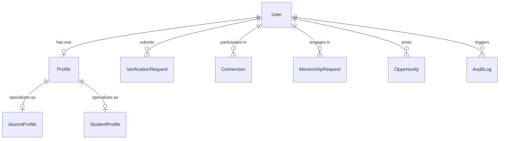

# Database Architecture & Migration Guide

## 1. Engine & Database System

- **Database Engine**: PostgreSQL 16 (Alpine distribution)
- **Object Relational Mapping (ORM)**: Prisma ORM v6
- **Cache & Pub/Sub Store**: Redis 7 (Alpine distribution)
- **Extensions**:
  - `uuid-ossp`: High-performance UUID generation
  - `pgcrypto`: Cryptographic hashing and token verification
  - `citext`: Case-insensitive text storage (used for email matching)

---

## 2. Schema Conventions

1. **Identifiers**: Primary keys are globally unique UUIDs (`@default(uuid())`) to prevent enumeration attacks and simplify distributed merging.
2. **Timestamps**: All tables maintain UTC `createdAt DateTime @default(now())` and `updatedAt DateTime @updatedAt`.
3. **Soft Deletion**: Sensitive entities (like `User`) feature a nullable `deletedAt DateTime?` field to support regulatory compliance without data disruption.
4. **Referential Actions**: Foreign keys define explicit referential constraints (e.g. `onDelete: Cascade` for profile ownership, `onDelete: SetNull` for audit records).
5. **Indexes**: Added strategically for foreign keys, emails, user roles, account statuses, and timestamp sorting columns.

---

## 3. Core Models



- **`User`**: Account identity, hashed passwords, verification status, role (STUDENT, ALUMNI, FACULTY, ADMIN).
- **`Profile`**: First/last name, bio, avatar, department, degree, graduation year, skills list.
- **`AlumniProfile`**: Company, title, industry, years of experience, mentoring/referral preferences.
- **`StudentProfile`**: Student ID, expected graduation, semester, target roles, target companies.
- **`VerificationRequest`**: Institutional ID verification documents and review workflow.
- **`Connection`**: Peer connection requests with acceptance status.
- **`MentorshipRequest`**: Structured mentorship cycles between student and alumni.
- **`Opportunity`**: Internships, full-time openings, and referral opportunities.
- **`AuditLog`**: Security compliance trail for security-critical actions.

---

## 4. Migration & Seeding Workflow

The repository includes an initial PostgreSQL migration at
`backend/prisma/migrations/20261105110000_initial_schema/`. It creates the complete current schema,
including candidate-validation profile and assessment tables. For a fresh local database, run:

```bash
cd backend
npx prisma migrate deploy
npm run prisma:seed
```

If you already have a database created from an earlier, untracked schema migration or `db push`,
do not blindly apply or mark the initial migration as applied. First compare the actual database
schema with the committed Prisma schema and decide how to baseline it; the initial migration is
intended for a fresh database.

### Generating New Migrations:
```bash
cd backend
npx prisma migrate dev --name <migration_description>
```

### Applying Migrations in Production:
```bash
cd backend
npx prisma migrate deploy
```

### Seeding Seed Data:
```bash
cd backend
npm run prisma:seed
```

### Interactive Database Explorer:
```bash
cd backend
npx prisma studio
```
